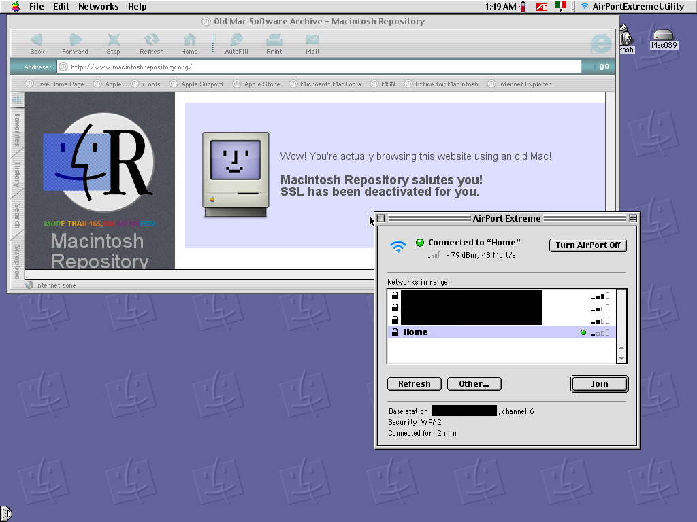
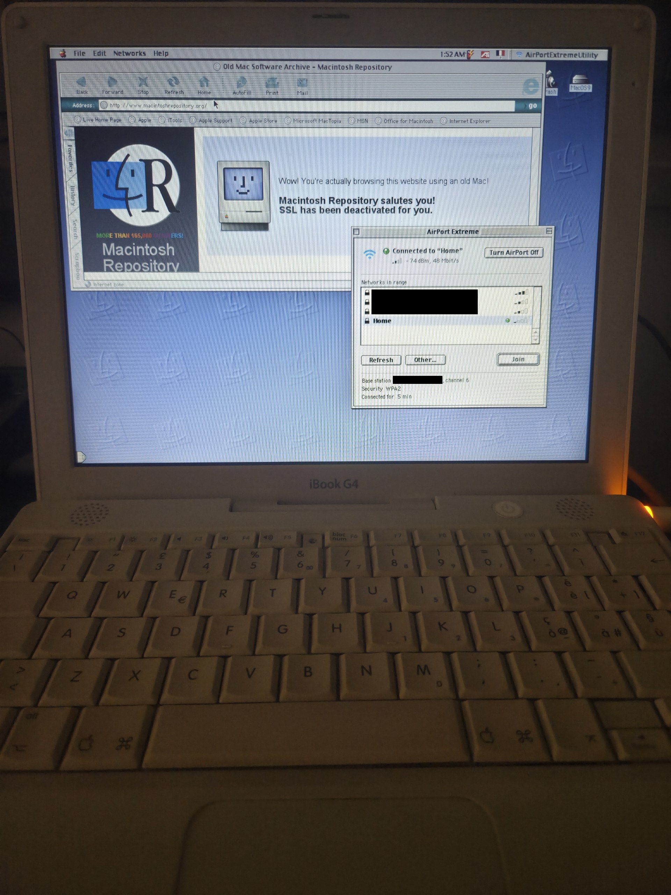
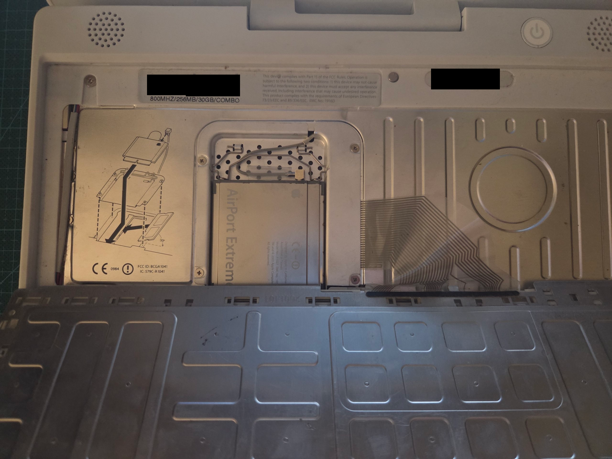

# AirPort Extreme for Mac OS 9

A driver for the original **AirPort Extreme** card (Broadcom BCM4306,
802.11b/g) on **Mac OS 9**, with an application to choose the network.

Instead of writing a new driver, it runs the Linux 5.15 wireless code
**unchanged**: `b43` (the chip), `ssb` (the bus), `mac80211` and `cfg80211`
(802.11), and the WPA supplicant of `wpa_supplicant` 2.11. This project
only adds the layer that maps the Linux kernel interfaces onto Mac OS 9 and
Open Transport.



<p>
  
  
</p>

## Status

Tested on an iBook G4 (BCM4306 rev 3, Apple 106B:004E) running Mac OS 9:

- [x] WPA and WPA2 personal (PSK), open networks; hidden networks
- [x] TCP/IP (DHCP or manual) and AppleTalk through Open Transport
- [x] the `AirPort Extreme` application: networks in range, signal, AirPort
      on/off, remembered networks, passwords in the Keychain
- [x] joins the last network at startup
- [ ] speed: see [Known limitation](#known-limitation-speed)
- [ ] WEP and WPA enterprise (802.1X) are not supported

## Installation

You need:

- a Mac with an AirPort Extreme card of the first generation (BCM4306)
  that runs Mac OS 9, with Open Transport and the Appearance Manager
  (Mac OS 9 has both);
- StuffIt Expander, to decode the files;
- once, a computer with Linux (WSL on Windows is fine) to extract the
  firmware.

### 1. The firmware

The card needs Broadcom's firmware, which is not free and cannot be
distributed with this project. Extract it yourself with `b43-fwcutter`,
exactly as Linux users do:

```sh
sudo apt install b43-fwcutter          # or your distribution's package
wget https://www.lwfinger.com/b43-firmware/broadcom-wl-6.30.163.46.tar.bz2
tar xjf broadcom-wl-6.30.163.46.tar.bz2
b43-fwcutter -w . broadcom-wl-6.30.163.46.wl_apsta.o
```

This writes a folder named `b43`. On the Mac, create a folder named
**`AirPort Extreme Firmware`** inside the System Folder and copy the `b43`
folder into it (only four of its files are used: `ucode5.fw`, `pcm5.fw`,
`b0g0initvals5.fw`, `b0g0bsinitvals5.fw`, which can also go directly in
`AirPort Extreme Firmware`). See [firmware/README.md](firmware/README.md)
for the details.

### 2. The programs

Download the files of the latest release, decode them with StuffIt
Expander, and put them here:

| File | Where |
|---|---|
| `AirPortExtreme` | System Folder → **Extensions** |
| `AirPort Extreme Startup` | System Folder → **Startup Items** (an alias is fine) |
| `AirPort Extreme` | wherever you like, for example Applications |
| `AirPortStatus`, `AirPortTester`, `OTCheck` | anywhere: they are only for problems |

### 3. First start

1. Restart.
2. In the **TCP/IP** control panel, choose the AirPort Extreme port
   ("Ethernet Slot B" on an iBook G4) and DHCP (or your manual settings).
3. Open **AirPort Extreme**, double-click your network and type its
   password.

From then on the Mac joins the same network at every startup.

## Using AirPort Extreme

- The led shows the state: **green** connected, **orange** looking for the
  network or joining it, **red** not connected (the reason is written next
  to it), **gray** AirPort off.
- **Double-click** a network (or select it and press Join) to join it. The
  application asks for the password if the Keychain does not have it;
  "Remember this network" keeps it in the Keychain.
- **Other...** joins a network that is not in the list (hidden).
- **Turn AirPort Off** turns the radio off; it stays off after a restart
  until you turn it on.
- **Networks → Forget Network** removes a remembered network and its
  password. A password the network refuses is forgotten at once and asked
  again.

Passwords are kept in the Keychain (service "AirPort Extreme"). The network
to join at startup, the remembered networks and the AirPort on/off state
are in the **AirPort Extreme Prefs** text file in the Preferences folder,
which the driver reads when it starts. The driver cannot read the Keychain:
`AirPort Extreme Startup` gives it the password at startup (and asks for the
keychain password if the keychain is locked).

The speed shown is the rate the radio link uses, not the speed you get
(see below).

## Reporting a problem

Problems and questions are welcome in the GitHub issues. Please attach:

1. **The report.** Open `AirPortStatus`: it saves **AirPort Extreme
   Report.txt** next to itself, with the Mac and Mac OS versions, the card,
   the state of the driver and its log. Network names are replaced by
   `<network 1>`, `<network 2>`..., so it can be posted publicly; have a
   look before posting anyway. (`AirPortStatus` also writes `AirPort
   Extreme.log`, the complete log, which does contain the network names.)

   In every log of the driver and of the Tester, MAC addresses keep only
   the manufacturer's part (`2c:91:ab:xx:xx:xx`): the address of an access
   point can be looked up in public databases that locate it.
2. **If the driver does not start at all**, the Tester runs the same code as
   a normal application and logs every step:
   - take `AirPortExtreme` out of the Extensions folder and restart (the
     Tester and the driver cannot use the card at the same time);
   - open `AirPortTester`, choose mode `1` (automatic), type the network
     name and password (or leave the name empty to only start the card and
     scan);
   - attach the `AirPortTester ... .log` file it writes (it contains the
     network names), and put `AirPortExtreme` back.
3. **If the Mac crashes or freezes**, install MacsBug, Apple's debugger:
   - look for **MacsBug 6.6.3** on Macintosh Garden or Macintosh Repository,
     put the `MacsBug` file in the System Folder (not in Extensions) and
     restart: "MacsBug installed" appears at the bottom of the startup
     screen;
   - when it crashes, MacsBug shows a text screen instead of a frozen Mac:
     take a photo of it, then type `StdLog` and Return (it saves a file
     named `StdLog` on the desktop) and attach both;
   - type `es` and Return to leave the crashed program, or `rs` to restart.

   The link maps in the release (`AirPortExtreme.map`, `AirPortTester.map`)
   turn the addresses on that screen into function names.

### Advanced settings

The preferences file can be edited with SimpleText, one `key=value` per
line; the application keeps the lines it does not manage.

| Setting | Meaning |
|---|---|
| `country=IT` | regulatory domain (ISO 3166 code), for the channels allowed; default: world |
| `firmware=<name>` | use the firmware in `AirPort Extreme Firmware:<name>:` |
| `debug=1` | more detail in the log: the dialogue with Open Transport, the first frames, chip and link counters every 10 s |
| `verbose=`, `pr_debug=`, `wpa_debug=` | messages of b43 (0..3), mac80211 (0/1), wpa_supplicant (0 = all .. 5) |
| `dma=0`, `irq=0` | PIO transfers instead of DMA, polling every 10 ms instead of the chip interrupt |
| `screen_log=1` | the log is also drawn on the screen, where it can be read (and photographed) if the Mac freezes |
| `watchdog=1` | logs where the driver is when it does not come back within 5 s |

`OTCheck` lists the Open Transport ports, loads TCP/IP and prints the error
it returns, if any.

## Known limitation: speed

The connection works but is slow (a few KB/s). The access point often does
not hear the frames the card sends: the acknowledgements of the frames it
receives, and sometimes the frames of the WPA handshake. It sends every
frame several times and falls back to 1 Mbit/s; some phone hotspots give up
and disconnect. Linux 3.2 on the same iBook, same place and same access
point, runs at 24-36 Mbit/s.

What has been ruled out so far, each with a test on the iBook:

- DMA against PIO, chip interrupts against polling: same behaviour.
- The firmware version (784.2 against 508.1084, the one Linux 3.2 used).
- Which antenna receives and which one sends the acknowledgements.
- The three radio setup values that b43 of Linux 3.2 writes differently
  from 5.15 for this card (G PHY rev 2, radio 2050 rev 2), applied after
  the initialization.
- The "no slow clock" board flag, the Power Manager idling the processor,
  the card's own MAC address against a locally administered one.
- Signal strength: a phone hotspot next to the iBook (-20 dBm) has the
  same problem.

The Tester's expert mode (`2`) has the tools used for these measurements: a
choice of firmware, an ARP and a ping test that count how many copies of
each frame the access point had to send, different ways of serving the
card, and a record of the register accesses. Help is welcome.

## Building from source

1. Build [Retro68](https://github.com/autc04/Retro68) for PowerPC with
   Apple's Universal Interfaces (`build-toolchain.bash --no-68k --no-carbon
   --universal`).
2. Make the import library of the Open Transport kernel fragments
   (`OT_KERNEL_LIB`) with Retro68's `MakeImport`, from the "Open Transport"
   extension of a Mac OS 9 system. Without it the driver is not built.
3. Build:
   ```sh
   cmake -S Build -B out -DCMAKE_TOOLCHAIN_FILE=<Retro68-build>/toolchain/powerpc-apple-macos/cmake/retroppc.toolchain.cmake \
         -DAPX_BUILTIN_FIRMWARE=OFF
   cmake --build out
   ```
   `Build/build.sh` does the same in a Linux virtual machine from Windows
   (`Build/build.sh release` for the files to publish).

With `-DAPX_BUILTIN_FIRMWARE=ON` (the default) the firmware in `firmware/`
is also built into the driver and the Tester, which is handy while
developing; such programs contain the firmware and **must not be
published**. `Build/build.sh release` builds without it and checks that no
file contains it (`Tools/check_no_firmware.py`).

Notes:

- GCC ignores the `#pragma options align=power` that `OpenTransportProtocol.h`
  uses for `struct module_info`, so the header's layout is wrong
  (`mi_idname` at offset 2 instead of 4); the driver declares its own copy.
- The import library holds both the kernel and the client versions of
  `OTGetIndexedPort` and `OTChangePortState`; the driver takes the kernel
  ones by name from `OTKernelUtilLib`.
- `Tools/png2icon.py` turns the PNGs in `icons/` into Mac OS 9 icon
  resources; `Tools/macbin_flags.py` sets the Finder flags Retro68 leaves
  off.
- `Tools/regen_all.py` regenerates `Common/` from the original
  `linux-5.15.225/` and `wpa_supplicant-2.11/` trees.

### Layout

| Folder | Contents |
|---|---|
| `Common/b43`, `ssb`, `mac80211`, `cfg80211`, `lib`, `include` | Linux 5.15.225 sources, unchanged |
| `Common/wpa/src` | wpa_supplicant 2.11 sources, unchanged |
| `Common/compat` | the Linux kernel API on Mac OS 9 (skb, net_device, timers, PCI, crypto...) |
| `Common/os9` | glue to Mac OS 9 (`b43os9.h`: the API used by the driver and the Tester; firmware files) |
| `Common/wpa/os9` | wpa_supplicant port (os, eloop, supplicant glue) |
| `AirPortExtremeDriver` | the Open Transport driver (`ndrv`, DLPI through DLPISupportLib), `AirPortStatus` and `OTCheck` |
| `AirPortExtremeUtility` | the `AirPort Extreme` application and `AirPort Extreme Startup` |
| `AirPortExtremeTester` | the Tester |
| `Build` | build with Retro68 |
| `Tools` | source import, firmware, icon and release scripts |
| `icons`, `imgs` | icons and screenshots |
| `firmware` | the Broadcom firmware for development builds (not included) |

## License

GPL-2.0 (see [LICENSE](LICENSE)), the license of the Linux code it contains.
wpa_supplicant is BSD-licensed ([Common/wpa/COPYING](Common/wpa/COPYING)).
The Broadcom firmware is proprietary and is **not** part of this project.

## Credits

All the hard work is by the authors of b43, ssb, mac80211, cfg80211 and
wpa_supplicant: see [CREDITS.md](CREDITS.md).
